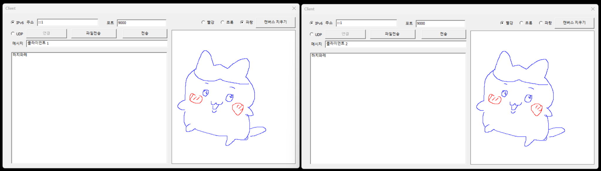
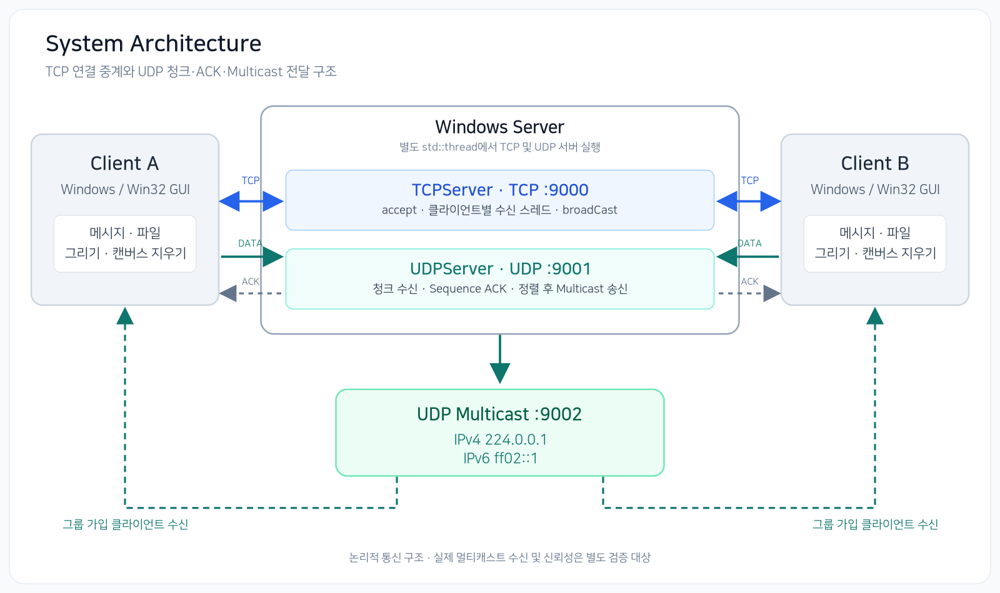

# Network Programming

**C++ / WinSock2 기반 TCP·UDP 멀티 클라이언트 통신 애플리케이션**

IPv4·IPv6 환경의 메시지·파일 전송과 실시간 공동 그리기를 구현한 **개인 프로젝트**입니다. 2024학년도 2학기 네트워크 프로그래밍 기말 과제로 개발했으며, 소켓 통신뿐 아니라 애플리케이션 계층의 메시지 형식과 UDP 청크 전송 절차를 직접 구현했습니다.

## Demo

| 영상 | 범위 |
| --- | --- |
| [**SHORT Demo (3분 30초)**](https://youtu.be/UaJfnlE5nP0) | IPv4 기반 TCP·UDP 통신 시연 |
| [**FULL Demo (8분)**](https://youtu.be/GdtCHSCHsuA) | IPv4/IPv6 × TCP/UDP 및 주요 기능 전체 시연 |



*IPv6/TCP(`::1`, 포트 `9000`) 환경에서 두 클라이언트의 메시지 수신 및 동일한 캔버스 그림을 확인한 화면입니다.*

## Project Overview

### 과제 요구사항

- IPv4/IPv6와 TCP/UDP의 네 가지 통신 조합
- TCP/UDP 기반 텍스트 및 이미지 파일 전송
- 두 개 클라이언트의 GUI, 서버 접속 및 메시지 전송
- 클라이언트 간 실시간 그리기 및 캔버스 지우기

이를 위해 **TCP 연결 기반 중계**와 **UDP 데이터그램 기반 중계**를 각각 구현했습니다. 특히 UDP 파일 전송을 위해 데이터를 청크로 분할하고, Sequence Number와 ACK로 *서버의 청크 수신*을 확인하는 방식을 적용했습니다.

## Key Features

- **TCP/UDP · IPv4/IPv6 선택:** GUI에서 통신 방식을 지정하고, 서버에는 IPv6 Dual-Stack 소켓을 구성
- **다중 클라이언트 통신:** TCP 연결별 수신 스레드와 서버 브로드캐스트를 이용한 메시지 중계
- **파일 전송:** 파일명과 바이너리 데이터를 전송하고 수신 측 `output/` 디렉터리에 저장
- **실시간 공동 그리기:** 색상 및 시작·종료 좌표를 전송해 다른 클라이언트에서 선을 그리고 캔버스 초기화 명령을 공유
- **UDP 청크 전송:** Sequence/TotalChunks 헤더, 서버의 ACK 송신, 수신 청크 정렬 및 멀티캐스트 전달

## Tech Stack

| 구분 | 사용 기술 |
| --- | --- |
| Language | C++17 (Server / Client) |
| Networking | WinSock2, TCP/UDP, IPv4/IPv6 |
| Concurrency | `std::thread` |
| GUI | Win32 API, GDI |
| Development | Visual Studio, MSVC `v143` |

## System Architecture



서버는 [`Server/main.cpp`](Server/main.cpp)에서 TCP 서버와 UDP 서버를 각각 별도 스레드로 실행합니다.

| 포트 | 통신 방식 | 역할 |
| --- | --- | --- |
| `9000` | TCP | 연결 수락 및 클라이언트 간 메시지·파일·그리기 명령 중계 |
| `9001` | UDP | 클라이언트 데이터 청크 수신 및 송신자에게 Sequence ACK 전송 |
| `9002` | UDP Multicast | 서버가 전송한 데이터를 그룹 가입 클라이언트가 수신 |

- **TCP:** [`TCPServer::acceptClient()`](Server/TcpServer.cpp)에서 연결마다 `receiveThread()`를 생성하고, `broadCast()`로 데이터 중계
- **UDP:** [`UDPServer::receive()`](Server/UDPServer.cpp)에서 청크를 모아 정렬한 뒤 IPv4 `224.0.0.1`, IPv6 `ff02::1`로 송신
- **Client:** [`Client::connectToServer()`](Client/Client.cpp)에서 통신 방식에 맞는 소켓을 생성; UDP 수신 시 별도 소켓으로 멀티캐스트 그룹에 가입

> 다이어그램은 코드상 논리 구조입니다. UDP 멀티캐스트는 별도의 클라이언트 연결이 없으며, ACK는 각 UDP 청크의 **원 송신자**에게 응답합니다.

## Network Protocol Design

메시지 타입은 TCP와 UDP에서 공통으로 사용합니다.

| 타입 | 값 | Payload |
| --- | --- | --- |
| `MESSAGE` | `0x01` | 텍스트 문자열 |
| `FILE` | `0x02` | `파일명?바이너리 데이터` |
| `DRAWING` | `0x03` | `색상?시작X:시작Y?종료X:종료Y` |
| `CLEARCANVAS` | `0x04` | 공백 문자 1바이트 |

### TCP — 5바이트 헤더

```text
+----------+--------------------+------------------+
| Type     | Payload Length     | Payload          |
| 1 byte   | 4 bytes            | 가변 길이         |
+----------+--------------------+------------------+
```

[`Client::sendData()`](Client/Client.cpp)는 헤더와 Payload를 각각 `send()`로 전달합니다. 서버는 수신한 메시지 타입에 따라 다른 클라이언트에게 데이터를 중계합니다. `MESSAGE`는 송신자에게도 재전송하고, `FILE`·`DRAWING`·`CLEARCANVAS`는 송신자를 제외합니다.

TCP는 바이트 스트림이므로 `send()`와 `recv()` 호출 단위가 일치하지 않을 수 있습니다. 현재 구현의 부분 송수신 처리 한계는 [Technical Limitations](#technical-limitations)에 기록했습니다.

### UDP — 13바이트 헤더와 청크별 ACK

```text
+---------+------------+------------+-------------+----------------+
| Type    | DataSize   | Sequence   | TotalChunks | Chunk Data     |
| 1 byte  | 4 bytes    | 4 bytes    | 4 bytes     | 최대 2035 bytes|
+---------+------------+------------+-------------+----------------+
```

`BUFSIZE = 2048`바이트이므로 UDP 청크의 최대 Payload는 `2048 - 13 = 2035`바이트입니다.

1. [`Client::sendData()`](Client/Client.cpp)가 전송 데이터를 청크로 나누고 `Sequence` 및 `TotalChunks`를 설정합니다.
2. 서버가 [`recvfrom()`](Server/UDPServer.cpp)으로 청크를 수신하고, 해당 Sequence 번호(4바이트)를 송신자에게 ACK로 돌려줍니다.
3. 서버는 수집된 청크 수가 `TotalChunks`와 같아지면 Sequence 순서로 정렬해 두 멀티캐스트 주소로 전송합니다.
4. 클라이언트는 멀티캐스트 패킷을 수신하고 청크를 정렬·결합해 메시지 타입에 따라 처리합니다.

이 ACK는 **서버가 청크를 수신했다는 응답**입니다. 최종 클라이언트 수신 보장이나 TCP 수준의 신뢰성을 뜻하지 않습니다. 실제 구현에서는 ACK 수신 타임아웃 및 중복 청크 처리 등의 보완이 필요합니다.

> 다중 바이트 정수 필드는 `memcpy`로 직렬화하며, 별도 네트워크 바이트 순서 변환은 구현되어 있지 않습니다.

## Key Implementations

| 구현 | 기술적 내용 | 관련 코드 |
| --- | --- | --- |
| **Dual-Stack** | IPv6 소켓에서 `IPV6_V6ONLY = 0` 설정 및 IPv4-mapped IPv6 주소 판별 | [`TcpServer.cpp`](Server/TcpServer.cpp), [`UDPServer.cpp`](Server/UDPServer.cpp) |
| **TCP 다중 접속** | `accept()` 후 클라이언트별 수신 스레드를 생성하고 `clients` 목록에 중계 | [`TcpServer.cpp`](Server/TcpServer.cpp) |
| **UDP 청크·ACK** | Sequence 기반 청크 송신, ACK 확인, 청크 정렬과 멀티캐스트 송신 | [`Client.cpp`](Client/Client.cpp), [`UDPServer.cpp`](Server/UDPServer.cpp) |
| **파일 수신** | `파일명?바이너리`를 분리해 `output/` 디렉터리에 저장 | [`Client.cpp`](Client/Client.cpp) |
| **공동 그리기** | `WM_MOUSEMOVE`에서 좌표 전송, 수신 측에서 GDI `MoveToEx()`·`LineTo()` 실행 | [`Client/main.cpp`](Client/main.cpp), [`Client.cpp`](Client/Client.cpp) |
| **GUI와 네트워크 연동** | 연결·메시지·파일·그리기 이벤트를 클라이언트 콜백으로 처리 | [`Client/main.cpp`](Client/main.cpp), [`Client.h`](Client/Client.h) |

## Getting Started

### 개발 환경

- Windows
- Visual Studio (Desktop development with C++ 워크로드)
- MSVC `v143` 툴셋 및 Windows SDK

### 빌드 및 실행

```powershell
git clone https://github.com/scr08212/Network-Programming.git
cd Network-Programming
```

1. Visual Studio에서 **`Server/TCP.sln`**을 엽니다. Server와 Client 두 프로젝트가 포함되어 있습니다.
2. `Debug | x64` 등의 빌드 구성을 선택하고 **Build Solution**을 실행합니다.
3. Server를 먼저 실행해 TCP `9000`, UDP `9001` 포트를 사용하도록 합니다.
4. Client를 두 번 실행하고, 각 GUI에서 서버 주소·포트 및 IPv6/UDP 사용 여부를 지정합니다.
5. 메시지 전송, 파일 전송, 그리기 및 캔버스 초기화를 확인합니다.

| 선택 | 서버 주소 예시 (동일 PC) | 서버 포트 |
| --- | --- | --- |
| IPv4 / TCP | `127.0.0.1` | `9000` |
| IPv6 / TCP | `::1` | `9000` |
| IPv4 / UDP | `127.0.0.1` | `9001` |
| IPv6 / UDP | `::1` | `9001` |

UDP 클라이언트는 멀티캐스트 수신을 위해 `9002`에 바인딩합니다. 멀티캐스트의 실제 동작은 네트워크 인터페이스·OS·방화벽 설정의 영향을 받을 수 있습니다.

**파일 전송:** 별도의 파일 선택 대화상자는 없으며, GUI의 메시지 입력란에 전송할 파일 경로를 입력한 뒤 **파일전송**을 클릭합니다. 수신 파일은 **현재 작업 디렉터리** 아래 `output/`에 저장됩니다.

## Testing & Verification

### 수동 기능 시연

[SHORT Demo](https://youtu.be/UaJfnlE5nP0)와 [FULL Demo](https://youtu.be/GdtCHSCHsuA) 촬영 과정에서 통신 조합 및 주요 기능을 테스트했습니다.

| 통신 조합 | 관찰한 결과 | 비고 |
| --- | --- | --- |
| IPv4 / TCP | 정상 동작 | 메시지·파일·그리기 등 기능 시연 |
| IPv6 / TCP | 재전송 후 정상 동작 | 이미지 전송 시 한 차례 `Unknown Type: 228` 및 불완전 수신 |
| IPv4 / UDP | 정상 동작 | UDP 데이터·ACK 및 멀티캐스트 송신 패킷 확인 |
| IPv6 / UDP | 정상 동작 | IPv6 멀티캐스트 송신 패킷 확인 |

위 결과는 실제 시연에서 관찰한 결과입니다. 반복 부하 테스트나 파일의 SHA-256 무결성 검사, 모든 네트워크 환경에서의 동작을 검증했다는 의미는 아닙니다.

### Wireshark 패킷 분석

Wireshark로 캡처한 실제 패킷에서 **TCP 메시지 형식과 서버 중계**, **UDP Sequence ACK와 멀티캐스트 송신**을 확인했습니다. 다음은 원본 캡처의 대표 프레임 발췌입니다.

**TCP — 메시지 헤더 및 서버 중계**

```text
Frame 113  Client → Server     01 13 00 00 00       (MESSAGE, 길이 19B)
Frame 115  Client → Server     Hello from client 1   (Payload 19B)
Frame 117  Server → Client A   헤더 + Payload        (24B)
Frame 119  Server → Client B   헤더 + Payload        (24B)
```

5바이트 헤더의 `0x01`은 `MESSAGE` 타입이며, `13 00 00 00`은 현재 구현의 Little Endian 기준으로 Payload 길이 19바이트를 나타냅니다. 서버가 동일한 메시지를 두 TCP 클라이언트에 전달한 것도 확인했습니다.

**UDP — 청크 ACK 및 멀티캐스트 송신**

```text
Frame 11191  Client → Server:9001       DATA, Seq=1, TotalChunks=1, "Client 1"
Frame 11192  Server → Client            ACK  01 00 00 00 (Seq=1)
Frame 11193  Server → ff02::1:9002      IPv6 Multicast
Frame 11194  Server → 224.0.0.1:9002   IPv4 Multicast
```

UDP 데이터그램의 수신에 대해 서버가 4바이트 Sequence ACK를 응답하고, IPv4·IPv6 멀티캐스트 주소로 메시지를 송신하는 과정을 확인했습니다.

> **검증 범위:** 발췌한 UDP 메시지는 단일 청크(`TotalChunks = 1`)입니다. ACK는 서버의 청크 수신을 확인할 뿐 최종 클라이언트 수신을 보장하지 않습니다. 이 캡처만으로 다중 청크 재조립의 정상 동작이나 TCP/IPv6 이미지 전송 오류의 원인을 입증할 수는 없습니다.

## Technical Limitations

- **TCP 메시지 경계 처리:** 서버는 헤더와 Payload를 각각 단일 `recv()`로 읽어 부분 수신 시 데이터 경계가 어긋날 수 있습니다. 클라이언트 역시 분할 헤더·연속 메시지 처리에 제약이 있습니다.
- **관찰된 이미지 전송 오류:** TCP/IPv6 이미지 전송 중 `Unknown Type: 228`과 불완전 수신을 한 차례 관찰했으며 같은 파일 재전송에는 성공했습니다. 부분 수신 처리가 원인 후보지만 원인은 확정되지 않았습니다.
- **UDP ACK 및 재조립:** ACK 대기에 수신 타임아웃이 없고, 중복 청크나 서로 다른 전송을 구별할 메시지 식별자가 없습니다. 따라서 데이터 전달과 재조립의 완전한 신뢰성을 보장하지 않습니다.
- **TCP 동시성:** 여러 수신 스레드가 `clients` 벡터를 동기화 없이 접근합니다.
- **입력 및 자원 관리:** 비정상 패킷, 파일 경로, 부분 송신 및 일부 소켓 종료 경로에 대한 추가 방어 처리가 필요합니다.
- **인코딩 및 이식성:** Windows 문자열 변환 API를 사용하며 UTF-8 기반의 명시적인 전송 규약 및 정수 필드의 네트워크 바이트 순서 변환은 구현하지 않았습니다.

## Project Structure

```text
Network-Programming/
├── Client/
│   ├── Client.cpp         # 송수신·파일·메시지 처리
│   ├── Client.h
│   ├── main.cpp           # Win32 GUI 및 그리기
│   ├── TEST2.rc           # GUI 리소스
│   └── TEST2.vcxproj
├── Server/
│   ├── BaseServer.cpp     # 공통 오류·종료 처리
│   ├── TcpServer.cpp      # TCP 연결 및 중계
│   ├── UDPServer.cpp      # UDP 청크·ACK·멀티캐스트
│   ├── main.cpp           # TCP·UDP 서버 스레드 시작
│   ├── TCP.sln            # Server + Client 솔루션
│   └── TCP.vcxproj
├── docs/
│   └── assets/
│       ├── architecture.png          # 정적 시스템 구성도
│       └── collaborative-drawing.png # IPv6/TCP 공동 그리기 실행 화면
├── DummyText.txt
├── cat.png
├── dog.jpg
└── README.md
```